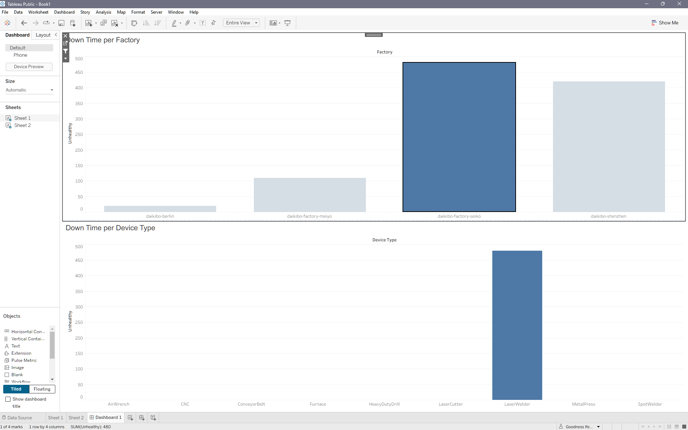

# Manufacturing Downtime Analysis

## Project Overview

This project explores manufacturing machine telemetry data to investigate machine downtime and identify patterns of unhealthy machine activity across different factories.

The analysis was completed as part of the Deloitte Australia Data Analytics Job Simulation on Forage.

## Project Objectives

- Explore machine telemetry data from multiple factories.
- Identify machines and factories with unhealthy activity.
- Investigate patterns in machine performance.
- Present findings through data visualisation.

## Tools Used

- Microsoft Excel
- Tableau

## Project Structure

- `data/` – Dataset used for the analysis.
- `excel/` – Excel workbook and analysis.
- `tableau/` – Tableau workbook and dashboard.
- `images/` – Screenshots of project visualisations.

## Analysis and Findings

The analysis explored machine downtime across four manufacturing factories using machine telemetry data.

### Key Areas of Analysis

**1. Downtime by Factory**

Compared the downtime recorded across the four factories:
- daikibo-berlin
- daikibo-factory-meiyo
- daikibo-factory-seiko
- daikibo-shenzhen

The comparison showed differences in downtime across the factories, with Seiko recording the highest value in the dashboard.

**2. Downtime by Device Type**

Investigated downtime across nine device types to understand which machines contributed most to downtime.

**3. Interactive Dashboard Filtering**

The Tableau dashboard includes an interactive filter that allows users to select a factory and investigate the downtime of individual device types within that factory.

For example, selecting Seiko filters the device type chart to show which machine types have the highest downtime in that factory.

### Key Insight

The interactive dashboard makes it possible to move from an overall comparison of factory performance to a more detailed investigation of machine-level downtime.

## Tableau Dashboard

## Conclusion

